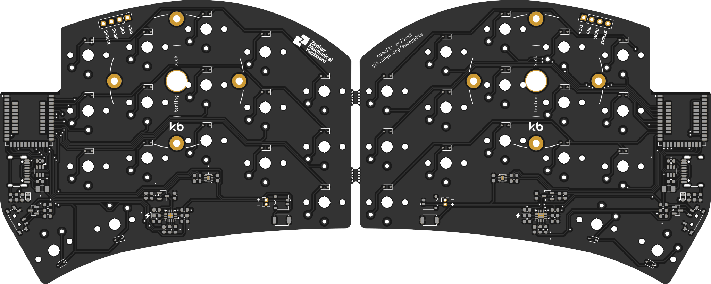

# Sweepa**ble**

A wireless [Ferris Sweep](https://github.com/davidphilipbarr/Sweep) variant designed with integrated nRF52840 (Holyiot 18010).

## Compatibility

This PCB has the exact same dimensions and mounting points (via SplitKB Tenting Puck mount) as original Sweep PCB. However, it may not be compatible with all existing cases, as the microcontroller's antenna overhangs the board slightly, and the USB-C connectors are located on the inner side of the board, opposed to the top. This PCB only supports soldered Choc V1 switches, as it is common to build this keyboard without a plate.

## Ordering

The following instructions will be for [JLCPCB](https://jlcpcb.com), but should generally apply to most PCB manufacturers.

1. Upload the Gerber files from [production/gerbers.zip](production/gerbers.zip)
2. Set the following parameters: (and change other things like PCB quantity and colour as desired)

- **Different Design**: 2

3. For PCB assembly, choose **Economic** PCBA type and **Top Side** for assembly side.
4. Upload the [BOM](production/bom.csv) and [CPL](production/positions.csv) files.
5. Ensure the correct components have been selected, and all are in stock. An effort has been made to choose as few extended components as possible, but this is not possible for some.
6. Give a quick look at the component placement and make sure nothing looks too out of place. It is normal for some components to be shown oriented incorrectly or not quite where they belong. The PCB reviewers will usually correct this without issue.

### Additional components

For components to be installed by hand:
| Item | Quantity | Remarks |
|------|----------|---------|
| Holyiot 18010 Module ([Aliexpress](https://www.aliexpress.us/item/3256804605353119.html)) | 2 | Unfortunately not carried by JLCPCB. Easy enough to solder by hand. |
| 3.7v LiPo Battery | 2 | The batteries sold by [boardsource.xyz](https://boardsource.xyz/products/jst-ble) are compatible with the JST connectors used on this PCB. Otherwise, nearly any will do. |
| Choc v1 Switches | 34 | Must be soldered. |

## Build Instructions

These steps assume you already have an assembled PCB and are installing only microcontrollers and switches. If you are hand-assembling the PCBs with all components, the [interactive BOM](https://html-preview.github.io/?url=https://github.com/waffle87/sweepable/blob/master/ibom.html) will be helpful.

1. Install and solder microcontrollers with antenna facing upwards.
2. Flash bootloader to microcontrollers using an appropriate programmer connected to the SWD pads broken out on PCBs. For this, one can use the [Adafruit nRF52 bootloader](https://github.com/adafruit/Adafruit_nRF52_Bootloader) and a [Black Magic debugger](https://black-magic.org). Afterwards, firmware can be flashed over USB.
3. Install batteries appropriately. Battery terminals are labeled on the PCB with + and -. Some adhesive can be used to secure them to the PCB if desired. The small dot marker near the power switches denotes the **off** position.
4. Install switches, keycaps, and case.

## Firmware

ZMK Firmware support for this keyboard can be found [here](https://git.pngu.org/zmk_build/tree/sweepable).
